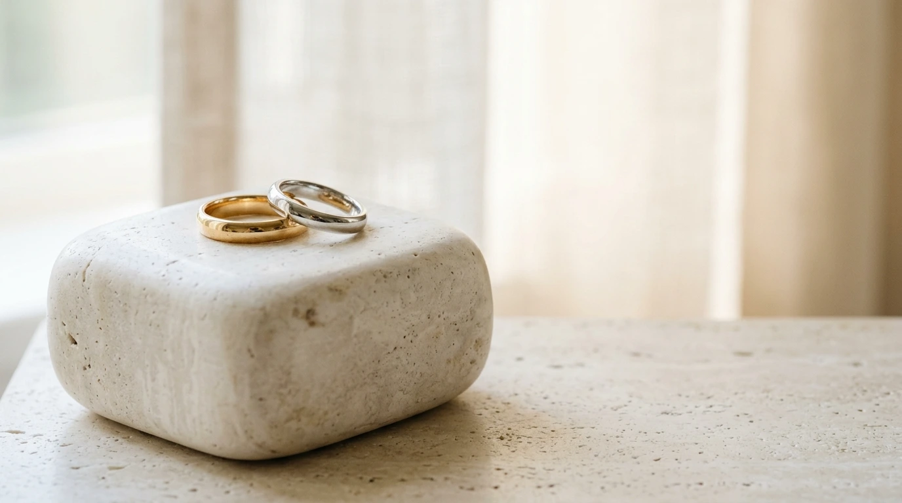
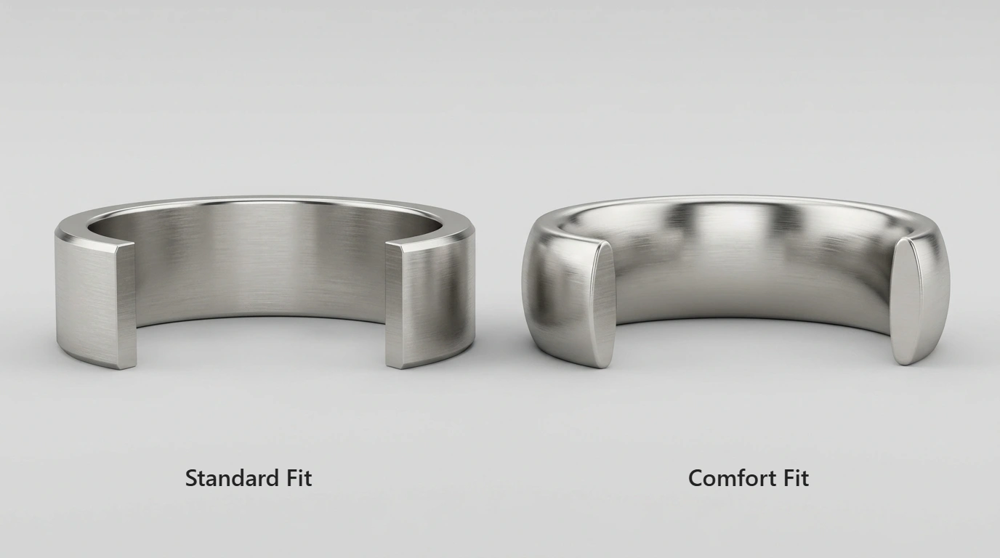
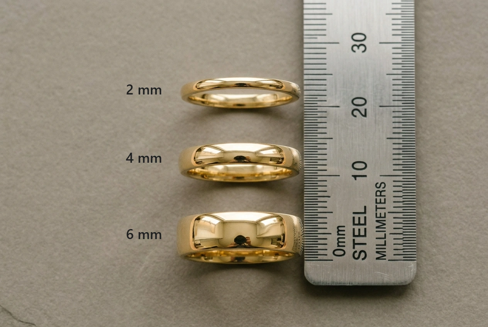
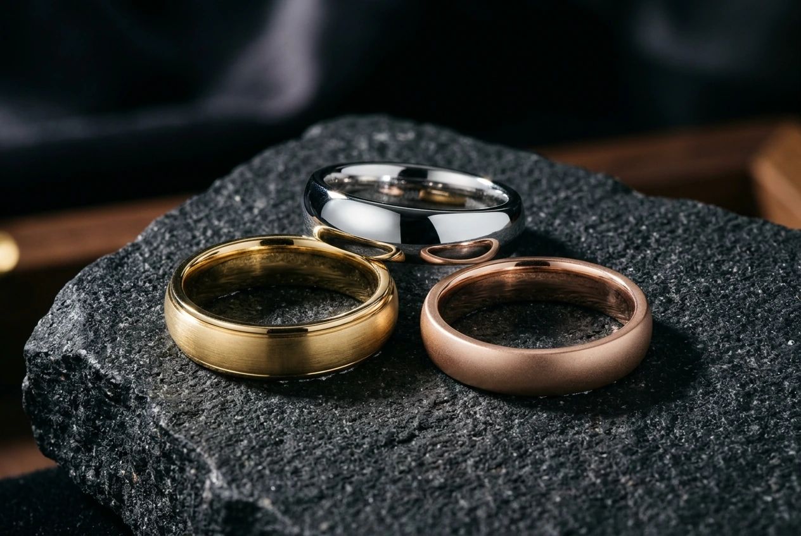
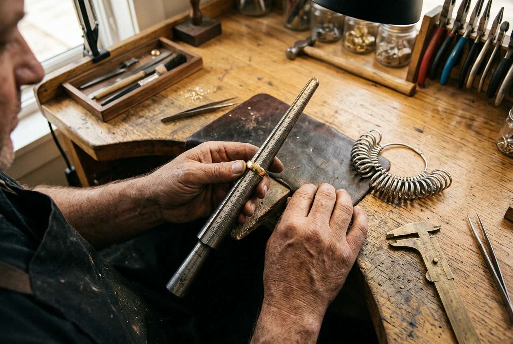

# Comfort Fit Wedding Bands: Benefits, Fit, and How to Choose the Right Ring

**Document Status:** Internal Review Draft (Unpublished / Not Deployed)  
**Target Publication:** SilverPetals Editorial / Knowledge Base  
**Primary Keyword:** comfort fit wedding bands  
**Suggested Slug:** `/comfort-fit-wedding-bands`

---

### Metadata & SEO Architecture

- **SEO Title:** Comfort Fit Wedding Bands: Benefits, Fit & Buyer's Guide (56 characters)
- **Meta Description:** Learn what comfort fit wedding bands are, how they compare to standard fit rings, width considerations, metal choices, and tips for finding the right fit. (154 characters)
- **Primary Keyword:** comfort fit wedding bands
- **Secondary Keywords:**
  - comfort fit wedding rings
  - comfort fit vs standard fit
  - wide comfort fit wedding bands
  - comfort fit men's wedding bands
  - comfort fit gold wedding bands
  - how should a wedding band fit
  - wedding band width and comfort
- **Target Word Count Range:** 2,100-2,400 words (Aiming for ~2,200 words)
- **Actual Word Count (Article Body):** 2,299 words
- **SEO Title Character Count:** 56 characters
- **Meta Description Character Count:** 154 characters

---

## Article Content
# Comfort Fit Wedding Bands: Benefits, Fit, and How to Choose the Right Ring

<!-- Image 1 Placement: Immediately below H1 -->

*Two classic comfort fit wedding rings in yellow gold and platinum, featuring gently domed interior shanks designed for everyday wear.*

---

### 1. Introduction: Why Ring Comfort Matters

A wedding band is worn through work, fitness, and rest, experiencing thousands of daily hand movements. Tactile comfort is just as vital as visual beauty; a ring that catches on knuckles quickly becomes frustrating.

In fine jewelry, **comfort fit wedding bands** provide effortless everyday wear. Unlike flat-interior rings, comfort-fit styles feature a domed inner wall engineered for natural finger movement. This guide explores comfort-fit construction, standard-fit comparisons, width and sizing considerations, and how to choose your ideal ring.

---

### 2. What Are Comfort Fit Wedding Bands?

"Comfort fit" describes the internal geometry of a ring shank resting against your finger. The interior metal forms a gentle convex dome rather than a flat plane:

```
Cross-Section View of Comfort Fit Interior:
Outer Surface:     --------------------------- (Flat, domed, or beveled)
                        ^               ^
                    Metal Core       Metal Core
                        v               v
Inner Surface:     (-------------------------) <--- Curved, domed interior wall
```

This curvature provides two ergonomic advantages:
1. **Contoured Contact Surface:** Removing sharp 90-degree corners lets tissue flex naturally.
2. **Relieved Edge Transition:** A rounded rim glides over expanding tissue during grip rather than pressing into skin folds.

Bench jewelers and CNC machining sculpt these ergonomic domes into virtually any precious metal.

---

### 3. Comfort Fit vs. Standard Fit Wedding Bands

<!-- Image 2 Placement: Under "Comfort Fit vs. Standard Fit Wedding Bands" -->

*(Technical diagram labels "Standard Fit" and "Comfort Fit" to be typeset manually in graphics software).*

A standard-fit band features a flat interior wall with uniform inside diameter. While flat edges suit narrow styles, they can feel rigid in wider profiles.

| Feature | Standard Fit | Comfort Fit |
| :--- | :--- | :--- |
| **Interior Geometry** | Flat wall | Gently domed curve |
| **Inner Rim Edge** | Straight corner | Softened, rounded rim |
| **Skin Contact** | Cylindrical contact | Contoured central contact |
| **Knuckle Movement** | Edge meets resistance | Rounded rim glides smoothly |
| **Grip & Flexion** | Edges press skin | Rounded edges reduce pressure |
| **Moisture** | Soap/water collect | Soap/water collect; drying needed |
| **Pricing & Weight** | Varies by metal/size | Varies by metal/size |

When comparing **comfort fit vs standard fit** designs, edge friction is the key difference: a curved rim glides over skin folds with noticeably less resistance.

---

### 4. Main Benefits of Comfort Fit Wedding Rings

Couples appreciate practical advantages during daily wear, though comfort varies with anatomy, dimensions, and preference.

<!-- Image 3 Placement: Under "Main Benefits of Comfort Fit Wedding Rings" -->

*A minimalist platinum comfort-fit band rests smoothly against the skin, offering comfortable wear during daily activities.*

#### A. Reduced Edge Pressure
When gripping steering wheels or tools, flat edges pinch fingers. A comfort-fit dome distributes contact smoothly, reducing localized pressure during flexion.

#### B. Smoother Movement Over Knuckles
For prominent knuckles, a convex interior acts as a ramp, easing the band over skin folds with less friction than flat corners.

#### C. Moisture and Skin Care Considerations
Soap and water collect under any ring. Relieved edges reduce suction, but curved interiors do not prevent irritation. Regular cleaning, removing rings before washing, and drying skin thoroughly remain essential.

#### D. Substantial Structural Feel
Comfort-fit bands often feature a thicker center wall than flat bands, providing reassuring heft that varies with metal and width.

> **Key Takeaway:** Overall comfort is an individualized experience depending on anatomy, width, geometry, surface finish, temperature, and personal preference.

---

### 5. Fit Considerations Across Band Widths and Styles

Whether a comfort-fit profile is beneficial depends heavily on band width and styling preferences:

#### Wider Band Considerations (Commonly 5 mm to 8 mm)
Broad bands create extensive skin contact where flat edges feel rigid. For broader rings, **comfort fit men's wedding bands** and wide bridal styles provide ergonomic relief, making 6 mm to 8 mm widths far less obtrusive during daily wear.

#### Narrower Band Considerations (Commonly 1.5 mm to 4 mm)
On delicate bands under 2 mm, interior curvature is subtle, yet comfort fit remains valuable:
* **Curved Stacking Bands:** Stacking rings increases coverage; rounded rims prevent flat edges from rubbing uncomfortably.
* **Medium-Width Bands:** Popular 3 mm to 4 mm bands benefit from rounded rims during finger flexion.
* **Sensitive Skin:** Softened inner rims reduce daily frictional contact.

---

### 6. How Ring Width Affects Comfort and Sizing

When choosing **comfort fit wedding rings**, width is the primary factor influencing tactile fit.

<!-- Image 4 Placement: Under "How Ring Width Affects Comfort and Sizing" -->

*Comparing narrow (2 mm), medium (4 mm), and wide (6 mm) bands illustrates how width alters skin coverage and tactile fit.*

#### The Mechanics of Wedding Band Width and Comfort
A narrow 2 mm band covers minimal skin, whereas **wide comfort fit wedding bands** (7 mm to 8 mm) displace substantial tissue during flexion:

```
Width Progression & Skin Coverage:
2 mm  ---> Minimal coverage; subtle fit difference
4 mm  ---> Classic width; noticeable comfort-fit advantage
6 mm  ---> Substantial coverage; comfort-fit strongly recommended
8 mm+ ---> Maximum presence; requires careful sizing evaluation
```

Understanding **wedding band width and comfort** prevents sizing errors: as width expands, interior curvature becomes vital to daily comfort.

#### Sizing Realities and GIA Guidance
Comfort-fit rings do not universally require sizing down:
* **Perceived Roominess:** Relieved rims let narrow bands (2 mm to 4 mm) glide easily; some size down a quarter size, while others retain standard sizing.
* **Wide Band Resistance:** Broader bands (6 mm to 8 mm) cover more tissue and fit snugger; wearers often keep their standard size or size up.
* **GIA Guidance & Jeweler Recommendations:** As [GIA](https://4cs.gia.edu/en-us/blog/how-to-determine-ring-size-tips-and-ring-size-chart/) notes, wide shanks cover more surface area and fit more snugly than narrow bands. While domed shanks slide easily over the knuckle, jewelers emphasize that there is no universal quarter-size downsizing formula; always test a comfort-fit sizing gauge in your intended band width.

---

### 7. Best Metals for Comfort Fit Wedding Bands

Metal selection influences visual style, density, tactile weight, and maintenance:

<!-- Image 5 Placement: Under "Best Metals for Comfort Fit Wedding Bands" -->

*Three distinct metal expressions: warm yellow gold, lustrous platinum, and romantic rose gold.*

#### 1. Comfort Fit Gold Wedding Bands (Yellow, White, and Rose Gold)
* **Yellow Gold:** 14k or 18k **comfort fit gold wedding bands** develop an esteemed patina.
* **White Gold:** Finished in rhodium plating requiring periodic replating.
* **Rose Gold:** Alloyed with copper for blush warmth; test first if sensitive.

#### 2. Platinum Comfort Fit Bands
Platinum is dense and biocompatible. While hypoallergenic for most, no metal is non-reactive for everyone. Surface scratches displace metal without shedding volume, creating a satin patina.

#### 3. Solid 925 Sterling Silver
An accessible, bright, lightweight option. Because silver is softer than gold or platinum, adequate wall thickness ensures lasting durability. Regular polishing preserves its luster.

#### 4. Contemporary Alternative Metals (Titanium & Tungsten Carbide)
* **Titanium:** Lightweight and corrosion-resistant, though bench resizing is extremely limited.
* **Tungsten Carbide:** Highly scratch-resistant with a gunmetal tone. It cannot be bench-resized; sizing adjustments require manufacturer replacement.

> **Pricing and Weight Note:** Price and weight depend on metal, purity, width, and craftsmanship. While domed interiors can use slightly more metal than flat bands of identical dimensions, pricing varies across designs.

---

### 8. Are Comfort Fit Rings Easier to Put On and Take Off?

In most cases, yes. The mechanical glide of a comfort-fit interior is a primary daily benefit, though ease of movement varies with knuckle anatomy and width:

```
Gliding Mechanics Over the Knuckle:
Standard Fit:    [Flat Corner Edge] ---> Pushes Against Skin Folds
Comfort Fit:     (Rounded Bevel)    ---> Glides Over Knuckle Contour
```

When sliding on, a standard band's flat edge catches on skin folds. A comfort-fit ring tapers toward the center dome, guiding the band smoothly over the joint.

#### How Should a Wedding Band Fit Once in Place?
Understanding **how should a wedding band fit** balances daily comfort with security:
* **Smooth On:** Slides over the knuckle with gentle pressure without forcing.
* **Comfortable at Rest:** Rests naturally at the finger base without restricted circulation.
* **Gentle Resistance Off:** Meets mild resistance at the knuckle, requiring a deliberate pull so it will not slip off during cold weather or washing.

---

### 9. How to Choose the Right Comfort Fit Wedding Band

Selecting your band balances aesthetics, finger anatomy, and daily lifestyle:

#### Step 1: Evaluate Daily Lifestyle
* **Hands-on routines:** Low-profile bands with rounded profiles prevent snagging on equipment.
* **Desk work:** Medium widths (3 mm to 5 mm) offer balanced palm comfort on flat desks.

#### Step 2: Choose Your Exterior Profile
While the interior is domed, the exterior comes in distinct silhouettes:
* **Traditional Domed (Court Shape):** Rounded inside and outside; classic bridal look.
* **Flat Exterior (Flat Court / Pipe Cut):** Flat outside with an ergonomic domed interior.
* **Beveled Edge:** Flat surface with angled chamfers; clean contemporary style.

#### Step 3: Match Hand Anatomy
* **Shorter fingers:** Narrow bands (2 mm to 4 mm) avoid crowding joints.
* **Longer fingers:** Wider bands (5 mm to 8 mm) provide balanced visual proportion.
* **Prominent knuckles:** Test comfort-fit gauges to balance knuckle clearance with stability; consult a jeweler about sizing beads if needed.

---

### 10. How to Find Your Correct Ring Size

Determining your accurate size for a comfort-fit band requires measurement tools reflecting curved interior profiles.

<!-- Image 6 Placement: Under "How to Find Your Correct Ring Size" -->

*A professional sizing consultation using a calibrated metal mandrel and sizing rings ensures dependable fit.*

#### Why Standard Flat Sizers Can Be Misleading
Plastic sizing belts and flat metal rings simulate standard-fit interiors. Higher edge friction can lead you to choose a size that feels loose in a comfort-fit ring.

#### Jeweler-Backed Sizing Recommendations:
1. **Request Comfort-Fit Gauges:** Test sizing rings with curved interiors matching your intended band width.
2. **Account for Band Width:** A 2 mm gauge fits differently than an 8 mm band; always test matching widths.
3. **Measure at Normal Temperature:** Measure at room temperature in the afternoon when finger size stabilizes.
4. **Test Ring Stability:** Move your hand naturally; the ring should remain seated without slipping.

For measurement techniques and conversion charts, consult our guide to finding your ring size *(publication pending)*.

---

### 11. Care and Maintenance Tips

Maintaining the comfort and appearance of a comfort-fit wedding band requires simple daily habits:

* **Clean the Interior Curve:** Soap and lotions accumulate along the inner curve. Soak the band in warm water with mild dish soap, then gently brush with a soft toothbrush.
* **Dry Thoroughly:** Slide the ring forward after handwashing so both skin and inner dome dry completely.
* **Preserve Interior Geometry:** When polishing scratches, ask your jeweler to avoid aggressive interior buffing to protect the domed contour.
* **Safe Storage:** Store the ring in a fabric-lined pouch during workouts or gardening.

For precious metal preservation instructions, explore our [Sterling Silver Jewelry Care Guide](article-silver-care.html).

---

### 12. Frequently Asked Questions (FAQs)

#### 1. Do comfort fit wedding bands run bigger than standard fit bands?
Comfort-fit rings share the central diameter of standard-fit rings of the same size, but rounded edges reduce friction. Some wearers perceive this as roomier, while others wear their usual size. Sizing down by a quarter size is not universal; test a comfort-fit gauge in your intended width.

#### 2. Can a comfort fit wedding band be resized easily?
Plain bands in gold, platinum, and silver are readily resizable by jewelers while preserving the inner dome. Alternative metals like tungsten carbide cannot be bench-resized, titanium resizing is extremely limited, and eternity bands are impractical to resize.

#### 3. How do I know if my ring is comfort fit or standard fit?
Inspect the inner edge. Standard-fit rings have flat interior walls meeting edges at sharp corners. Comfort-fit bands curve outward, feeling rounded and smooth along the inner rim.

#### 4. Does a comfort fit wedding band cost more than a standard fit band?
Cost depends on metal, width, thickness, and craft. While domed interiors can use slightly more metal than flat bands of identical dimensions, prices vary across manufacturers.

#### 5. Should my wedding band match my engagement ring's fit profile?
Matching profiles is not required. While paired comfort-fit bands sit flush together, a comfort-fit band provides ergonomic benefits even alongside a flat-interior engagement ring.

---

### 13. Conclusion: Choosing a Lifetime of Comfortable Wear

Your wedding band accompanies you through every daily moment. While precious metals express style, the internal fit profile determines how much you enjoy wearing your ring every day.

By choosing a **comfort fit wedding band**, you select an ergonomic profile engineered for natural finger movement. Whether you prefer classic gold, platinum, or artisanal sterling silver, evaluating interior comfort ensures your ring remains a joy to wear for a lifetime.

At **SilverPetals**, fine jewelry is crafted to feel as effortless as it looks. Explore our handcrafted [Sterling Silver Rings](shop.html?category=rings), discover styling inspiration in our [Creative Ring Stacking Guide](article-ring-stacking.html), or review our [gemstone care recommendations](gemstones.html) to curate your ideal set.
---

## 3. Unique Image Strategy & Generation Prompts

```
Visual Asset Directory:
|-- Image 1: Hero Header (Gold & Platinum Bands on Sculptural Ivory Stone)
|-- Image 2: Cross-Section Comparison (Technical Product Visualization - No AI Text)
|-- Image 3: Real-Life Lifestyle (Platinum Band on Hand beside Coffee Cup)
|-- Image 4: Width Comparison (Three Yellow Gold Bands on Warm Grey Surface)
|-- Image 5: Metal Trio (Yellow Gold, Platinum, Rose Gold on Dark Charcoal Stone)
\-- Image 6: Bench Craft & Sizing (Jeweler Measuring Band with Mandrel & Gauges)
```

### Image 1 -- Hero Image
- **Placement:** Immediately below H1.
- **Suggested Dimensions:** 1200 x 630 px (16:9 Landscape)
- **Filename:** `comfort-fit-wedding-bands-guide.webp`
- **Alt text:** Gold and platinum comfort fit wedding bands arranged on ivory stone.
- **Caption:** Two classic comfort fit wedding rings in yellow gold and platinum, featuring gently domed interior shanks designed for everyday wear.
- **Detailed AI Generation Prompt:**
  > Editorial commercial jewelry photography, wide landscape composition. Two elegant polished plain wedding bands--one warm 18k yellow gold and one lustrous platinum--arranged gracefully on a smooth, sculptural off-white travertine stone block. Soft diffused morning window light entering from the left, casting delicate, subtle shadows. Clean minimalist styling with generous negative space on the right, high-end luxury editorial aesthetic, crisp focus on the polished metallic curves, 8k resolution, shot on 50mm f/2.0 lens.

### Image 2 -- Inner Profile Comparison
- **Placement:** Under "Comfort Fit vs. Standard Fit Wedding Bands."
- **Suggested Dimensions:** 1000 x 600 px (5:3 Ratio)
- **Filename:** `comfort-fit-vs-standard-fit-profile.webp`
- **Alt text:** Cross-section comparison of flat standard-fit and rounded comfort-fit wedding band interiors.
- **Caption:** Technical cross-sectional visualization comparing a flat standard-fit interior with an ergonomically rounded comfort-fit interior. *(Labels typeset manually).*
- **Production Instruction:** Generate a clean technical visual with NO text, words, or letters. The labels "Standard Fit" and "Comfort Fit" must be typeset manually in design software or HTML.
- **Detailed AI Generation Prompt (Clean Visual Only -- No Text):**
  > Precise 3D technical CAD product visualization showing two distinct wedding band cross-sections side by side on a neutral light grey seamless background. Straight-on eye-level view. The left cutaway band exhibits a completely flat inner surface with defined 90-degree internal corner edges. The right cutaway band exhibits a smooth, ergonomically rounded, convex inner surface. Realistic brushed silver and white gold metal shaders, crisp edge highlights, studio softbox lighting, clean geometric technical rendering style, completely clean of text, labels, numbers, or diagram annotations.

### Image 3 -- Real-Life Wearing Comfort
- **Placement:** Under "Main Benefits of Comfort Fit Wedding Rings."
- **Suggested Dimensions:** 900 x 600 px (3:2 Ratio)
- **Filename:** `comfort-fit-wedding-band-everyday-wear.webp`
- **Alt text:** Platinum comfort fit wedding band worn during an everyday activity.
- **Caption:** A minimalist platinum comfort-fit band rests smoothly against the skin, offering comfortable wear during daily activities.
- **Detailed AI Generation Prompt:**
  > Candid lifestyle photography, side-angle perspective. A person's relaxed hand rests naturally on an ivory textured linen tablecloth beside a minimalist handmade ceramic coffee mug in a sunlit breakfast nook. On the ring finger is a plain, understated platinum comfort-fit wedding band. Natural morning daylight, authentic soft skin texture, warm domestic ambiance, shallow depth of field, quiet luxury lifestyle photography aesthetic, captured on 35mm f/1.8 lens.

### Image 4 -- Ring Width Comparison
- **Placement:** Under "How Ring Width Affects Comfort and Sizing."
- **Suggested Dimensions:** 1000 x 600 px (5:3 Ratio)
- **Filename:** `wedding-band-width-comparison.webp`
- **Alt text:** Narrow, medium, and wide yellow-gold wedding bands arranged for width comparison.
- **Caption:** Comparing narrow (2 mm), medium (4 mm), and wide (6 mm) bands illustrates how width alters skin coverage and tactile fit.
- **Production Instruction:** Do not generate digital numerical labels. Add verified measurement callouts manually in graphics software.
- **Detailed AI Generation Prompt:**
  > Studio product photography from a slightly elevated 45-degree oblique angle on a matte warm-grey slate surface. Three distinct plain polished yellow-gold wedding bands of visibly different widths--narrow 2mm, medium 4mm, and wide 6mm--arranged in a neat vertical row. Resting neatly alongside the bands is a clean brushed stainless steel millimeter ruler providing visual proportion. Soft diffused overhead studio lighting, crisp metallic reflections, organized educational flat-lay layout, sharp depth of field across all three bands.

### Image 5 -- Metal and Finish Comparison
- **Placement:** Under "Best Metals for Comfort Fit Wedding Bands."
- **Suggested Dimensions:** 900 x 600 px (3:2 Ratio)
- **Filename:** `comfort-fit-wedding-band-metal-options.webp`
- **Alt text:** Yellow-gold, platinum, and rose-gold wedding bands displayed on dark stone.
- **Caption:** Three distinct metal expressions: warm yellow gold, lustrous platinum, and romantic rose gold.
- **Detailed AI Generation Prompt:**
  > High-end fine jewelry photography. Three individual comfort-fit wedding rings arranged in an artistic triangular composition on a textured dark charcoal basalt stone slab. One ring is crafted in rich 18k yellow gold with a subtle satin-brushed finish; the second is polished mirror-finish platinum; the third is warm 14k rose gold with a soft matte finish. Dramatic directional studio lighting creating elegant rim highlights and showcasing the authentic distinct hues of each precious metal, rich contrast, luxury catalog editorial style.

### Image 6 -- Professional Ring Sizing
- **Placement:** Under "How to Find Your Correct Ring Size."
- **Suggested Dimensions:** 900 x 600 px (3:2 Ratio)
- **Filename:** `professional-comfort-fit-ring-sizing.webp`
- **Alt text:** Jeweler checking a wedding band with a ring mandrel and professional sizing gauges.
- **Caption:** A professional sizing consultation using a calibrated metal mandrel and sizing rings ensures dependable fit.
- **Detailed AI Generation Prompt:**
  > Overhead documentary-style jewelry workshop photograph. An experienced jeweler's hands holding a plain gold wedding band on a stepped, engraved steel ring mandrel over a clean, organized wooden workbench. A ring of silver-colored metal finger sizing gauges lies nearby alongside brass calipers and a leather bench pad. Warm, focused task lighting, authentic jeweler's patina, sharp focus on the ring and measuring tools, documentary craft aesthetic.

---

## 4. Internal Link Audit

| Link Anchor Text | Target Destination | Status & Verification Notes |
| :--- | :--- | :--- |
| *Sterling Silver Rings* | `shop.html?category=rings` | **Verified in Repository:** File `shop.html` exists on disk. |
| *Sterling Silver Jewelry Care Guide* | `article-silver-care.html` | **Verified in Repository:** File `article-silver-care.html` exists on disk. |
| *Creative Ring Stacking Guide* | `article-ring-stacking.html` | **Verified in Repository:** File `article-ring-stacking.html` exists on disk. |
| *gemstone care recommendations* | `gemstones.html` | **Verified in Repository:** File `gemstones.html` exists on disk. |
| *guide to finding your ring size* | *(Unlinked placeholder text)* | **Pending Publication:** Article 1 exists only as a local draft (`review-draft-article-1-ring-size.md`) and is not live. Target URL `how-to-find-your-ring-size.html` will be linked upon deployment. |

*Note on Live URLs:* Live HTTP requests to `silverpetals.online` could not be tested due to permission boundaries; all verification was conducted directly against local repository files.

---

## 5. Concise Change Log

1. **Word Count Recalibration:**
   - Condensed redundant phrasing, repetitive transitions, and overlapping descriptions to achieve an exact article body count of 2,299 words (comfortably within the 2,100-2,400 word target, aiming for ~2,200 words).
   - Preserved all 13 core outline sections, all 5 FAQs, all 6 image placement tags & captions, all 3 ASCII diagrams, and all essential sizing/metal caveats.
2. **Ring Sizing & GIA Accuracy:**
   - Clarified that comfort-fit rings feel different from flat-interior bands of the same nominal size due to reduced edge friction.
   - Recommended trying a comfort-fit sizing gauge matching the desired width.
   - Referenced official GIA guidance regarding wider shanks fitting more snugly while explicitly attributing caution against universal quarter-size downsizing rules to professional jewelers.
3. **Removed Absolute Benefit Claims:**
   - Replaced "elimination of edge pinching" with "reduced edge pressure during hand movement."
   - Replaced "superior knuckle clearance" with "smoother movement over prominent knuckles."
   - Removed claims that curved interiors improve airflow to prevent irritation. Clarified that soap and moisture collect under any ring, emphasizing regular cleaning and thorough skin drying.
   - Preserved explicit guidance that overall comfort depends on anatomy, width, geometry, surface finish, temperature, and personal preference.
4. **Corrected Surface Contact Language:**
   - Removed unsupported claims of "100% surface contact" for standard-fit rings. Described interior geometry accurately without invented percentages.
5. **Metal Claim Refinements:**
   - Removed claims that platinum is ~60% denser than 14k gold. Described platinum as dense and biocompatible.
   - Qualified platinum's hypoallergenic properties by noting that no metal is non-reactive for every wearer.
   - Removed claims that rose gold is more scratch-resistant than yellow gold.
   - Clarified that price and weight depend on material, alloy, dimensions, and craftsmanship.
6. **Lifestyle & Styling Nuance:**
   - Reframed width ranges as stylistic examples rather than strict gender standards.
   - Maintained that fit is an individual experience and recommended professional jeweler consultation.
7. **FAQ Improvements:**
   - FAQ 1 clarifies that sizing down a quarter size is not a universal rule and recommends testing a width-matched comfort-fit gauge.
   - FAQ 4 clarifies that price and weight depend on metal, width, thickness, and craft.
8. **Internal Link Integrity:**
   - Relative links point to verified repository files (`shop.html`, `article-silver-care.html`, `article-ring-stacking.html`, `gemstones.html`).
   - Article 1 reference kept as natural unlinked text pending publication.
9. **Image Production Controls:**
   - Retained all six distinct concepts.
   - Specified manual typography for technical diagrams (Image 2 and Image 4).
   - Documented that actual image assets in `assets/images/` are pending generation.

---

## 6. Remaining Pre-Publication Checklist

- [ ] **Deploy Article 1:** Export `review-draft-article-1-ring-size.md` to `how-to-find-your-ring-size.html` so the internal link in Section 10 can be activated.
- [ ] **Generate Image Assets:** Create WebP files for all six concepts (`comfort-fit-wedding-bands-guide.webp`, etc.) and place them in `assets/images/`.
- [ ] **Manual Typography for Diagram (Image 2):** Typeset the labels "Standard Fit" and "Comfort Fit" onto the clean CAD graphic before publishing.
- [ ] **Manual Typography for Width Scale (Image 4):** Typeset the millimeter scale callouts onto the width comparison photo before publishing.
- [ ] **HTML File Generation for Article 2:** When authorized, convert `review-draft-article-2-comfort-fit-wedding-bands.md` into `comfort-fit-wedding-bands.html` with site navigation, header, and footer.